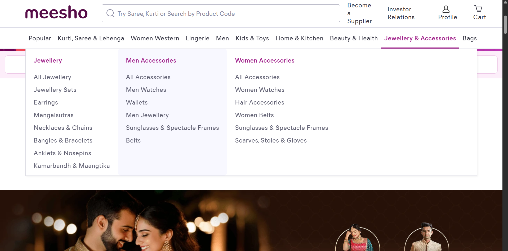
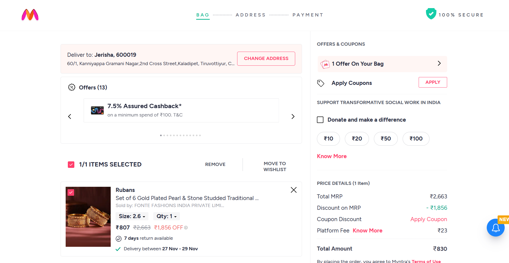
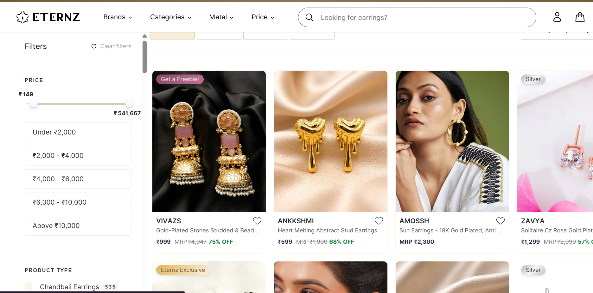
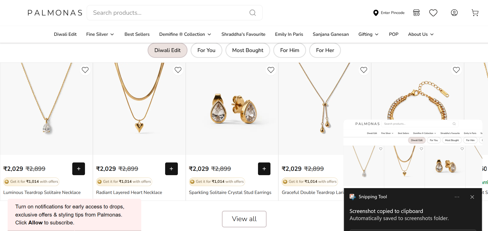
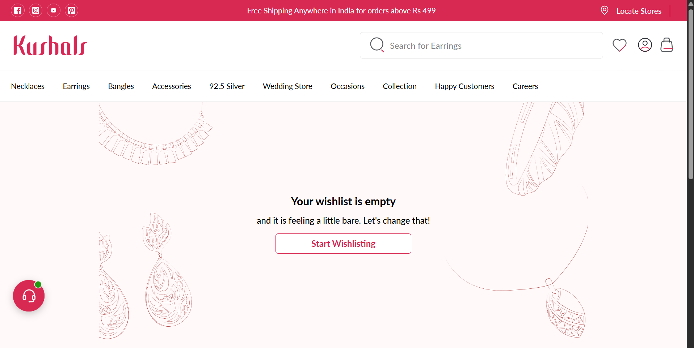
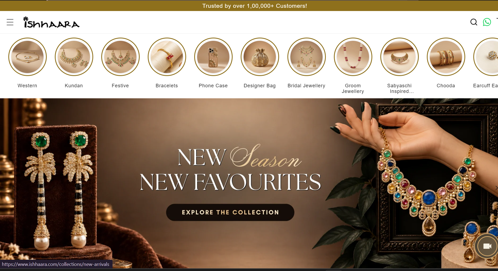

# Competitor teardown — desk research

**Date:** 21 Nov 2026 · **Task:** T-00-03 · **Status:** Screenshots filed 21 Nov 2026

This teardown covers positioning, onboarding shape, fees where published, catalogue design, delivery, and returns. One live screen per target is in `00-product-vision/competitors/`.

Targets: Meesho, Myntra, Eternz, plus three Instagram-heavy fashion-jewellery sellers (Palmonas, Kushals, Isharya).

## Comparison

| | Meesho | Myntra | Eternz | Palmonas | Kushals | Isharya |
|---|---|---|---|---|---|---|
| Who it serves | Mass-market resellers and bargain shoppers across every category | Fashion-led department store, branded apparel and jewellery | Premium jewellery, leaning fine / demi-fine and established brands | Demi-fine, Instagram-native, everyday gold-plated | Fashion jewellery specialist with a strong Instagram catalogue | Occasion and bridal fashion jewellery, social-first |
| Seller onboarding | Open reseller model. Low barrier, catalogue is uneven | Brand / vendor onboarding is a business contract, not a 15-minute phone wizard | Curated. Small imitation sellers generally cannot join | Not a marketplace. One brand | Largely one brand / retail chain, not open multi-vendor | One brand, not open multi-vendor |
| Fee (public) | Reseller margins vary; not a clean "15% and you ship" story | Marketplace commission is negotiated per brand, not published as one rate | Not an open commission marketplace | N/A (owns inventory / brand) | N/A | N/A |
| Design quality | Dense, discount-first, low craft | Strong photography, filters, and app polish | Editorial, luxury, lookbooks | Clean product photography, social-native campaigns | High volume of SKUs, commercial rather than cinematic | Campaign imagery, festive drops |
| Filters that matter for jewellery | Generic marketplace filters | Colour, price, brand, some occasion | Metal, occasion, style — built for jewellery but for finer product | Material, plating, occasion on its own site | Style, occasion, price on its own site | Occasion, type, plating |
| Delivery | Platform-assisted / mixed; COD is central | Platform logistics, reliable tracking, COD common | Brand-controlled premium shipping | Brand ships its own orders | Brand / retail shipping | Brand ships |
| Returns | Liberal, category-dependent, COD makes abuse expensive | Defined windows, branded trust | Premium policy, not built for ₹300 imitation pieces | Brand policy, hygiene limits typical for jewellery | Standard fashion retail window | Brand policy |
| What a small Instagram seller feels | Volume, but the page looks cheap and the category is buried | Hard to get in; the site is not theirs | The closest "beautiful jewellery" player, and it is not for them | A quality bar they are compared with, but they cannot list beside it | Proof that fashion jewellery can be a destination | Proof that festive looks sell, still a single brand |

## Ideas to adopt

1. **Myntra's photography and filter discipline.** Square, centred product images, occasion and colour filters, and a product card that shows price, MRP, and rating without clutter. This is D1, D2, and the photo guide in module 01.
2. **A short seller path, without Meesho's free-for-all.** Anyone can apply, and an admin still checks KYC plus the first five listings (Q-16, module 08). The wizard stays phone-first and under 15 minutes.
3. **Eternz-style looks, at fashion-jewellery prices.** Curated "complete the look" sets across vendors (D5, module 04), with one fixed premium template so small sellers do not have to design a store (Q-12, module 09).

## Ideas to avoid

1. **Meesho's visual language and COD-led checkout.** Bargain density fights the premium positioning, and COD breaks fee collection and buyer protection (Q-06, modules 06 and 13).
2. **Burying jewellery inside a general marketplace.** Kitchenware and electronics next to jhumkas is the problem statement in module 00. The catalogue, attributes, and skin-safety tags stay jewellery-only (D1, D6).
3. **Fine-jewellery curation that shuts out Instagram sellers.** Eternz's brand bar is the gap Auralis exists to fill. Do not require established brands, gold, or diamonds for approval (D3, module 08).
4. **One-brand Instagram checkout as the model.** Palmonas, Kushals, and Isharya prove demand and taste. They do not offer a cart across sellers, held payouts, or a dispute path. Those are D4 and D7, not features to copy from their storefronts.

## Screenshots

Jewellery sits inside a general marketplace menu on Meesho, next to Home & Kitchen.

Myntra bag: one jewellery line, a return window, a delivery date, and a platform fee on the same screen.

Eternz earring listing with price filters, MRP, and discount. The grid is jewellery, and the price ceiling runs into fine-jewellery territory.

Palmonas product grid: plain background, price, and a second strikethrough price. A screenshot-tool popup sits on the corner of the capture; the grid is still readable.

Kushals header shows category navigation and free shipping over Rs 499. This capture is the empty wishlist, not a product grid.

Ishhaara (spelled ISHHAARA on the site) new-arrivals page: campaign photography and category chips. The public URL on the capture is `https://www.ishhaara.com/collections/new-arrivals`.

