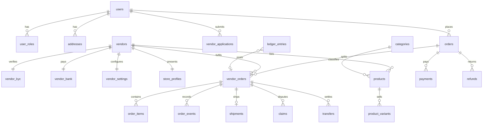

# ERD — schema v1

Migrations live in `apps/api/db/migrations`. Money columns are `bigint` paise. Vendor-owned tables carry `vendor_id` and row-level security for `app_user`.

Identity: `users`, `user_roles`, `addresses`, `otp_requests`, `refresh_tokens`.

Vendor: `vendor_applications`, `vendors`, `vendor_kyc`, `vendor_bank`, `vendor_settings`, `store_profiles`, `collections`, `collection_products`, `dashboard_layouts`, `seller_agreement_acceptances`.

Catalog: `categories`, `attributes`, `category_attributes`, `products`, `product_variants`, `price_history`, `media`, `looks`, `look_items`, `reviews`, `vendor_ratings`, `wishlists`, `follows`.

Commerce: `carts`, `cart_items`, `orders`, `vendor_orders`, `order_items`, `order_events`, `stock_reservations`, `shipments`, `claims`, `pincodes`.

Finance: `payments`, `transfers`, `refunds`, `ledger_entries`, `commission_rules`, `invoices`, `payout_holds`, `reconciliation_runs`, `reconciliation_items`.

Platform: `notifications`, `notification_templates`, `notification_preferences`, `support_tickets`, `moderation_items`, `config`, `feature_flags`, `cms_sections`, `banners`, `audit_log`, `outbox`, `webhook_events`, `idempotency_keys`.
